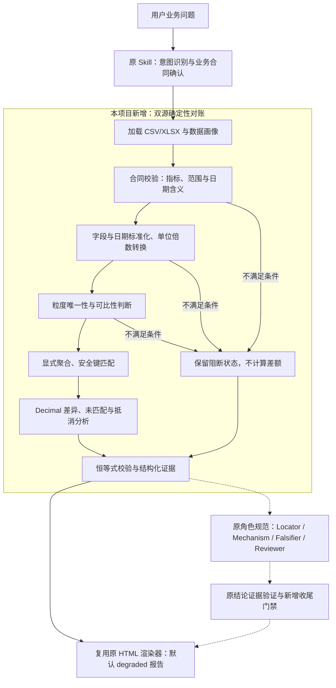

# 设计多元经营指标一致性审计 Skill

**Multi-Source Business KPI Consistency Audit Skill**

基于 [小马学数分 Data Analysis Skill](https://github.com/xiaomaxueshufen/data-analysis) 增量二次开发，面向多源经营报表中指标口径不一致、数据粒度不同、金额差异难定位的问题。当前是处理两个本地 CSV/XLSX 来源的演示 MVP。

**核心设计：先判断数据能不能可靠对账，再执行安全匹配、差异定位和证据审查。** 指标定义、范围或业务键不满足条件时，保留阻断结果，避免把不可比数据算成“差异结论”。

[查看四个 Demo](#demo-展示) · [快速运行](#快速运行) · [原项目与个人贡献](#原项目与个人贡献) · [简历项目描述](docs/resume.md)

## 业务背景与痛点

**业务场景示例：** 运营报表与财务报表统计同一经营指标，却给出不同金额。排查前，需要确认两边是否采用相同的指标定义、日期含义、统计范围和金额单位，再检查粒度与重复键，匹配记录并分解差额。

本项目将可明确表达的校验和计算步骤标准化：先检查可比性，再区分匹配金额差异、单侧缺失和正负抵消，为后续业务核验提供可追溯明细。该场景用于说明问题，**不代表已接入真实企业运营或财务系统**。

## Demo 展示

以下报告与结构化工件已保存在仓库中，金额差异统一按 **A − B** 计算。

| 演示场景 | 已核实的主要结果 | 报告与明细 |
|---|---|---|
| 正常对账 | A=30，B=30，净差=0；`READY_EXACT / consistent` | [HTML](docs/demos/consistent/report.html) · [汇总](docs/demos/consistent/summary.json) |
| 金额差异 | A=30，B=27，净差=3；业务键 `002` 的金额为 20 对 17；`different` | [HTML](docs/demos/value_mismatch/report.html) · [差异明细](docs/demos/value_mismatch/details.csv) |
| 口径冲突 | 指标定义不一致；`BLOCKED / not_assessed`，不计算差额 | [HTML](docs/demos/definition/report.html) · [阻断结果](docs/demos/definition/summary.json) |
| 公开零售模拟双源 | A=33,083.61，B=33,090.86 GBP；按日期/地区聚合后净差=−7.25 GBP；`READY_AGGREGATE / different` | [HTML](docs/demos/public_retail/report.html) · [汇总](docs/demos/public_retail/summary.json) |

GitHub 文件页展示 HTML 源码，下载后用浏览器打开，或按下方命令在本地生成并打开报告。以上报告均保留 `degraded` 标记。

公开零售案例由 **同一 UCI Online Retail II 数据集**的前 2,000 行派生出两种视图，并在 B 的 `2009-12-01 / Australia` 分组人工注入 +7.25 GBP。它验证已知差异能否被识别，**不代表真实独立双系统对账或企业事故**。抽样、注入与数据许可见 [provenance.json](examples/cross_audit/public_retail/provenance.json) 和 [ATTRIBUTION.md](ATTRIBUTION.md)。

## 二次开发核心功能

| 功能 | 解决的问题 |
|---|---|
| 指标语义合同校验 | 检查已确认的指标定义、单位、币种、加总方式及统计范围，避免同名异义 |
| 可比性判断与业务阻断 | 定义、范围、日期含义不一致或缺少确认时，停止对应比较 |
| 字段映射与显式聚合 | 将来源字段映射到合同字段；仅在明确的比较键上对可加总指标求和 |
| 唯一键检查与安全匹配 | 先校验来源粒度，再按键匹配，阻断重复粒度和多对多膨胀风险 |
| 双侧未匹配记录识别 | 分别记录 `only_in_a / only_in_b`，缺失一侧留空，不当作零金额 |
| Decimal 金额与容差 | 保留十进制金额，分别检查逐键差异与累计总差容差 |
| 正负抵消与恒等式核验 | 同时输出净差、正负及绝对差异，核对总差与分项是否闭合 |
| 结构化证据与离线 HTML | 输出合同、差异明细、输入/合同/引擎哈希；复用上游渲染器生成报告 |
| 对抗测试与回归验证 | 覆盖日期错配、时间戳截日、非法合同、工件状态篡改及审查降级处理 |

对账恒等式：**A 总额 − B 总额 = 匹配记录差额 + 仅 A 存在的金额 − 仅 B 存在的金额**。净差为零也可能存在抵消；聚合模式只能说明指定分组的一致性，不能外推为逐笔一致。

实现入口：[da_cross_reconcile.py](scripts/da_cross_reconcile.py)；合同、标准化、匹配与计算见 [对账引擎](scripts/reconcile/engine.py) 和 [架构说明](docs/architecture.md)。

## 系统架构

下图展示跨源问题的处理路径，不要求原 Skill 顺序运行全部分析算子。实线为确定性 CLI 路径；虚线为由 Skill 协调、需要实际执行并留痕的角色审查流程。



CLI 负责确定性计算与默认报告，**不会自动启动四角色 Agent**。角色审查需要由 Skill 运行环境另行协调；本地角色 JSON 与校验通过不能认证真实独立执行，也不使本项目达到生产审计标准。

## 快速运行

在仓库根目录执行。以下 PowerShell 步骤沿用 [复现说明](docs/reproduce.md)，增加合成案例生成命令；自带公开派生样本无需下载原始大文件，也不需要 API 密钥。

```powershell
python -m venv .venv
.\.venv\Scripts\python.exe -m pip install -r requirements-audit-dev.txt
New-Item -ItemType Directory -Path .audit-test-tmp -Force | Out-Null
$env:PYTHONUTF8='1'

# 重建合成案例；再运行三个合成 Demo 和一个公开派生样本 Demo
.\.venv\Scripts\python.exe scripts/generate_cross_audit_cases.py
.\.venv\Scripts\python.exe scripts/run_cross_audit_demos.py

# 复现全量测试；每次使用新的 basetemp 目录名
.\.venv\Scripts\python.exe -m pytest -q -p no:cacheprovider --basetemp .audit-test-tmp/fresh-run --junitxml outputs/local-tests.xml
```

运行后查看 `outputs/cross-audit-demos/index.json`，其中列出四次运行目录；用浏览器打开各目录的 `report.html`。每次运行生成独立目录，保留历史结果。

只运行金额差异案例，可调用实际 CLI：

```powershell
.\.venv\Scripts\python.exe scripts/da_cross_reconcile.py `
  --source-a examples/cross_audit/value_mismatch/a.csv `
  --source-b examples/cross_audit/value_mismatch/b.csv `
  --config examples/cross_audit/value_mismatch/contract.json `
  --output-root outputs/manual-demo
```

该案例预期退出码为 `1`，表示发现差异；一致为 `0`，业务阻断为 `3`，需确认合同为 `4`，输入/执行错误为 `2`。CLI 输出 JSON 中的 `run` 指向本次报告目录。

依赖文件 [requirements-audit-dev.txt](requirements-audit-dev.txt) 锁定历史实测环境；其中 openpyxl 3.0.10 低于上游 [requirements.txt](requirements.txt) 的 >=3.1 声明。它用于复现实测，不能视为新环境或生产依赖验证。若改用上游依赖版本，应重新运行测试。

## 测试与质量保障

**2026-10-19 的指定本地环境中，155 项测试通过，0 失败、0 错误、0 跳过。** 此数字来自已保存的发布验证，不是本次 README 修改后重新执行的测试。

| 测试来源 | 数量 |
|---|---:|
| 上游原项目测试 | 74 |
| 本项目新增跨源及审计测试 | 81 |
| 其中：独立审计期间新增回归（包含在 81 项内） | 14 |
| 合计 | 155 |

实测环境：Windows、Python 3.11.5、pandas 2.0.3、numpy 1.26.0、openpyxl 3.0.10、pytest 7.4.0。测试包括固定答案、随机性质、CLI 端到端、输入防护与审计反例回归。

[发布验证记录](docs/release-validation.md) · [JUnit 记录](docs/release-tests.xml) · [独立审计与修复](docs/independent-audit.md) · [跨源测试](tests/test_cross_audit.py) · [审计回归](tests/test_independent_audit.py)

当前仓库未配置 GitHub Actions 工作流；上述结果不代表在线 CI、多 Python 版本持续集成或生产规模验证。

## 原项目与个人贡献

| 范围 | 原作者提供 | 本项目增量二次开发 |
|---|---|---|
| Skill 与分析方法 | 通用数据分析 Skill、意图识别、方法包与单源算子 | 新增跨源审计路由、方法说明和双源执行入口 |
| 数据比较 | 表内合计/小计对账等单源能力 | 指标合同、可比性阻断、标准化、粒度校验与安全对齐 |
| 金额核验 | 原有分析及证据框架 | Decimal 跨源差额、双侧未匹配、抵消与对账恒等式 |
| 审查与报告 | 四角色审查规范、结论证据验证、HTML 渲染器 | 跨源证据适配、导出明细核验与收尾门禁集成 |
| 样例与测试 | 原有公开案例及 74 项测试 | 合成案例、公开模拟双源样本及新增 81 项测试 |

上游功能、代码和 74 项测试不计为个人原创。开发使用 AI 辅助；个人职责应与实际参与和可解释程度一致。详见 [贡献归属](ATTRIBUTION.md)、[原仓库基线](docs/upstream-baseline.md) 和 [简历项目描述](docs/resume.md)。原项目完整功能说明请查看 [上游仓库](https://github.com/xiaomaxueshufen/data-analysis)。

## 项目限制

- 定位为本地演示 MVP，未完成真实独立双系统验收或生产规模验证。
- 不自动判断哪个来源正确，不自动证明差异根因，也不自动修复业务数据。
- 合同确认与输入提取完整性依赖业务证据；相同口径字符串不等于口径已被外部认证。
- 工件校验尚不等于从原始输入端到端独立复算，哈希记录也不是不可篡改证据链。
- 本地 Agent 工件无法独立认证实际角色执行。
- 仅支持明确可加总指标；不支持复杂多对多结算、隐式会计/汇率转换。时间戳需先按业务时区显式预处理；聚合结果可能掩盖组内抵消。

完整边界见 [独立审计报告](docs/independent-audit.md)。文档中的早期“未推送”等记录属于开发阶段历史，当前项目已公开发布，不据此改写历史结论。

## 原作者归属与许可证

本项目基于 [小马学数分 / xiaomaxueshufen 的 data-analysis](https://github.com/xiaomaxueshufen/data-analysis) 增量二次开发，保留上游 Git 历史、原 LICENSE 和版权通知。

Required Notice: Copyright 小马学数分 (xiaomaxueshufen, https://github.com/xiaomaxueshufen)

采用 [PolyForm Noncommercial License 1.0.0](LICENSE)，保留非商业用途限制；本项目不另行授予覆盖上游的商业授权。公开数据来自 UCI Online Retail II，按 CC BY 4.0 标注来源、抽样与修改，详见 [ATTRIBUTION.md](ATTRIBUTION.md)。
