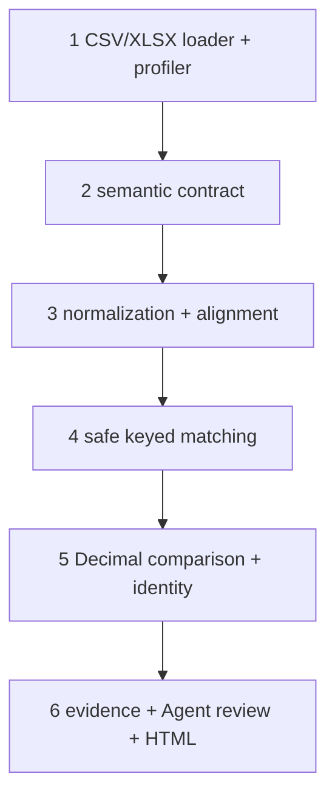

# 六层架构

入口 `scripts/da_cross_reconcile.py`，内部包 `scripts/reconcile/`。包放 scripts 下以兼容原仓库直接运行脚本的导入约定，不修改原单源算子接口。CSV 读取所有值为文本；XLSX 使用只读 openpyxl，数字型 ID 不恢复丢失前导零，要求来源用文本存储。规范化只执行明确日期格式和单位倍数，无隐式 trim/大小写转换。先验证来源业务粒度唯一性，再向合同比较键聚合；不使用多对多 merge。

内部 `audit(a, b, config)` 返回结果对象，CLI 负责输入、异常与工件；金额输出十进制字符串，避免 JSON float 再次舍入。`da_verify` 只承担结论证据审查，新引擎承担数学校验，不能混用“不一致”与“计算失败”。
